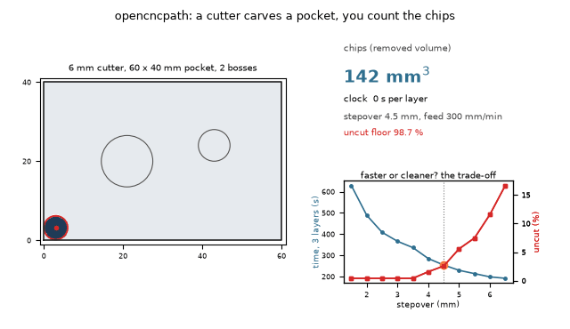
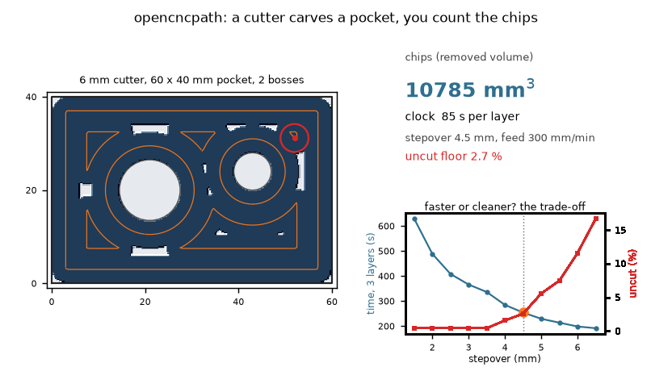
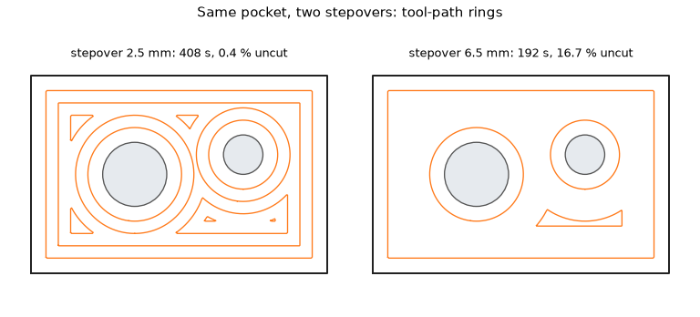
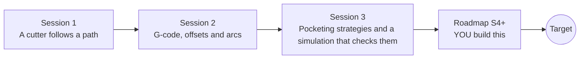

# opencncpath

[](https://github.com/KrunalPanchal1995/opencncpath/actions/workflows/ci.yml)   [](https://colab.research.google.com/github/KrunalPanchal1995/opencncpath/blob/main/sessions/session-01/lesson.ipynb) [](https://krunalpanchal1995.github.io/opencncpath/)

**Turn a drawing into a CNC toolpath, in three sessions.**

opencncpath teaches how a cutter path is built from an outline: offsets, G-code, arcs, stepover and a height-map check, using only Python and a browser.

- **Start from zero.** Session 1 needs only a ruler's worth of geometry: a path, a radius and a speed.
- **See it cut.** Every session ships a slider app that runs in the browser, with labelled graphs.
- **Know you got it right.** Each session ends with a checkpoint that prints PASS or FAIL against hand calculations and a simulation.
- **Build the missing half.** The repo stops at Session 3 on purpose; the roadmap shows the path to the Target.

[Target](#the-target) · [Who is this for](#who-is-this-for) · [Quick start](#quick-start) · [Sessions](#sessions) · [Roadmap](#roadmap) · [Contribute](#contribute) · [Explainer PDF](docs/explainer.pdf)

> **This repo is incomplete on purpose.** Sessions 1 to 3 are here and fully working. The finished Target below is a preview of what the community can build next. We show you the path, not the code. Sessions 4 and up are yours.

## The Target

A flat cutter clears a rectangular pocket that has two round bosses. Its tool-path rings bend round the bosses, the cutter carves a simulated height-map, and counters show the chips (removed volume), the machine clock and the percentage of floor left uncut. Beside it a trade-off curve shows how a bigger stepover saves time but leaves more material. Your goal over the coming sessions: build that planner and simulator yourself.



*Target: a cutter carves a pocket with two bosses while chips, time and the stepover trade-off are counted*



*Target, last frame: carved height-map, counters and the time versus uncut curves*



*The same pocket with a small and a large stepover: more rings and time against more uncut floor*

Try it live:

- [Math Visual Studio: open the Studio](https://krunalpanchal1995.github.io/studio/)

How the Target was made is shown only as a path in [promo/roadmap.md](promo/roadmap.md).

## Who is this for
**diploma / undergraduate to advanced undergraduate (levels 5-6).** Topic area: Mechanical Engineering.

Prerequisites:

- Distance between two points and the area and perimeter of a rectangle and a circle (school geometry).
- Python 3.10 or newer; if `python --version` works, you are ready. PRIMER.md explains the rest.
- No prior GitHub, CAD or machining experience is needed. This repo teaches toolpath geometry only, not how to operate a machine.

New to Python? Read [PRIMER.md](PRIMER.md) first (10 minutes).

## Quick start

No installation knowledge needed. You need [Git](https://git-scm.com/downloads) and [Python 3.10+](https://www.python.org/downloads/) (Windows: tick "Add Python to PATH"). On Mac and Linux type `python3` wherever this page says `python`.

```bash
git clone https://github.com/KrunalPanchal1995/opencncpath.git
cd opencncpath
python start.py 1
```

`start.py` creates a private environment, installs what is needed and runs Session 1 with its checkpoint. Next: `python start.py 2`, `python start.py 3`, or `python start.py test` to check everything. Only a checkpoint: `python start.py check 1`.

Five lines turn the idea of Session 2 into a result (they work as they are): Save it as `try.py` and run it with `python start.py run try.py` (this uses the private environment, where NumPy is installed):

```python
import numpy as np
w, h, d, F = 40.0, 30.0, 6.0, 300.0           # pocket 40 x 30 mm, 6 mm cutter, feed 300 mm/min
n = int(np.ceil((h - d) / 4.0)) + 1             # zigzag lines at most 4 mm apart
length = n * (w - d) + (h - d)                  # cutter-centre path per layer, mm
print(n, length, round(length / F * 60, 1))     # -> 7 262.0 52.4 (seconds per layer)
```

Every session also opens in your browser with sliders (no install): [live apps](https://krunalpanchal1995.github.io/opencncpath/). Or use the Colab badge above for the notebook.

## Sessions

| # | Session | Model level | Time | Live app |
|---|---|---|---|---|
| 1 | [A cutter follows a path](sessions/session-01/README.md) | Level 1: conceptual interactive model | 60 min | [open](https://krunalpanchal1995.github.io/opencncpath/session-01/) |
| 2 | [G-code, offsets and arcs](sessions/session-02/README.md) | Level 2: mathematical engineering model | 75 min | [open](https://krunalpanchal1995.github.io/opencncpath/session-02/) |
| 3 | [Pocketing strategies and a simulation that checks them](sessions/session-03/README.md) | Level 3: simulation and validation | 90 min | [open](https://krunalpanchal1995.github.io/opencncpath/session-03/) |

Each session follows the same six steps: A real-world problem, B concept and theory, C visual explanation, D interactive simulation, E worked example and experiment, F assessment and design challenge. Each ends with `checkpoint.py`, which prints `PASS` or `FAIL` against reference numbers. Session 3 also contains the real-world mini-project: **Generate G-code for a pocket with a boss and check it**.

## Architecture



| Folder or file | What is inside |
|---|---|
| `sessions/` | three sessions: README (A-F), `lesson.py`, notebook, live app, exercises, activity sheet, checkpoint |
| `promo/` | the Target: media, live links, and the roadmap (path only) |
| `docs/` | `explainer.tex` and the built `explainer.pdf` |
| `tests/` | runs every lesson and checkpoint headless |
| `start.py` | one command to set up and run anything |
| `QUALITY.md`, `RUBRIC.md` | the quality checklist and the scoring rubric |
| `.github/` | CI, PDF build, Pages deploy, issue and PR templates |

## Roadmap

| Milestone | What you will build | Difficulty |
|---|---|---|
| Session 4: Offset any convex polygon | A function that returns the inward offset of a convex polygon and a pocket path for a hexagon. | intermediate |
| Session 5: Contour-parallel pocket with a boss | A planner that clears the boss pocket with continuous rings and one plunge per layer. | intermediate |
| Session 6: Rest machining of the corners | A second pass with a 2 mm cutter that follows the corner leftover left by the 6 mm cutter. | advanced |
| Session 7: 3D ball-end finishing | Parallel finishing passes over a hemisphere of radius 15 mm with a ball cutter of radius 3 mm, simulated on a 3D height-map. | advanced |
| Session 8: Post-processor dialects | A writer that outputs arcs with I, J and with the R word, and a parser that reads both. | advanced |

Full detail with a checkpoint per milestone: [promo/roadmap.md](promo/roadmap.md).

## Contribute
New to GitHub? Read [CONTRIBUTING.md](CONTRIBUTING.md); it starts from zero. Pick an issue labelled `good first issue`. Translations into Hindi, Telugu, Tamil and Malayalam are welcome.

<details>
<summary>Development</summary>

```bash
python start.py test        # runs every lesson and checkpoint
```
Lessons use `# %%` cell markers so they open as notebooks in VS Code. See [QUALITY.md](QUALITY.md) for the standard every session meets.
</details>

## License
MIT. See [LICENSE](LICENSE). Media in `promo/media` is (c) Krunal Panchal, CC BY 4.0.

## Acknowledgments
Part of the [PAN IIT OSS](https://hellofoss.tech-iitb.org/projects) open-source teaching collection, modelled on the structure of [openspline](https://github.com/openspline/openspline). Built on ideas from the Math Visual Studio at https://krunalpanchal1995.github.io/studio/.
