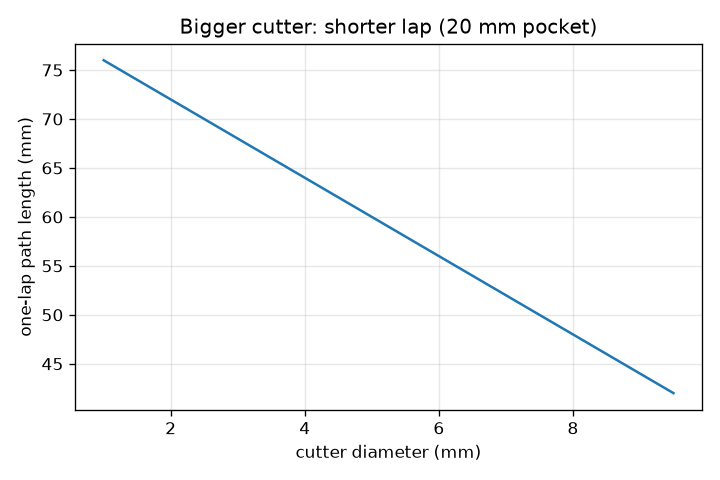
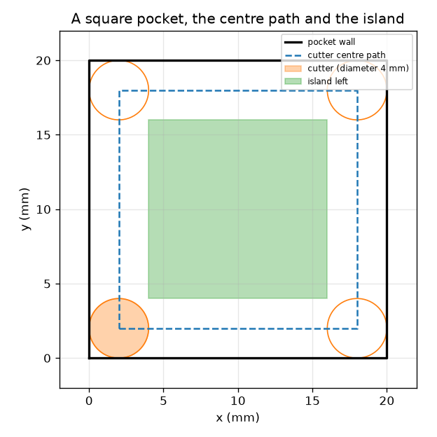

# Session 1: A cutter follows a path

*Level 1 (conceptual interactive model) · about 60 minutes · opencncpath*

> This is a simplified educational model. It is not a validated design tool and must not be used for real structures, electrical installations, vehicles, industrial processes or medical decisions.

**Prerequisites**

- Distance between two points; perimeter of a square.
- You have read PRIMER.md and run `python start.py 1` once.

**Learning objectives.** After this session you can:

- Explain that a CNC machine moves a cutter, like a plotter moves a pen, along a list of coordinates.
- Find the path of the cutter centre for a square pocket: the wall moved inwards by one cutter radius.
- Predict the island that one lap leaves in the middle.
- Compute the time of a path from its length and the feed.

## A. Real-world problem
A plotter draws by moving a pen to coordinates. A CNC (computer numerical control) milling machine does the same with a spinning cutter that carves material instead of ink. To carve a square pocket, the machine needs a list of points for the cutter centre, not for the wall. Where must the centre go so that the cutter edge just touches the wall, and how long does one lap take? Educational geometry only: real machining needs trained operators, machine-specific post-processing and safety checks.

## B. Concept and theory
The cutter is a disc of diameter d, radius r = d/2, seen from above. If its edge must touch the wall, its centre must stay r away from the wall: the centre path is the wall moved inwards by r, a smaller square of side (side - 2r) = (side - d). The disc removes everything within r of its centre, so one lap clears a strip of width 2r = d along each wall (the four inside corners stay slightly rounded). What is left in the middle is an island, a square of side (side - 4r) = (side - 2d) if that is positive. The feed F is the speed along the path in mm per minute, so a path of length L takes L / F minutes.

| Symbol | Meaning | Unit |
|---|---|---|
| side | side of the square pocket | mm |
| d | cutter diameter | mm |
| r | cutter radius, d/2 | mm |
| F | feed rate (speed along the path) | mm/min |
| L | length of the cutter-centre path | mm |
| t | time for the path | s |

**Assumptions**

- The cutter is a flat disc seen from above and moves at constant feed.
- One lap only; no plunging, no acceleration, no rapid moves.
- The pocket is a perfect square with its corner at (0, 0).
- Educational geometry: this is not a machining recipe.

$$ r=\frac d2,\qquad L=4\,(\text{side}-d) $$

$$ t=\frac{L}{F}\cdot 60\ \text{s}\quad(F\ \text{in mm/min}) $$

$$ \text{island side}=\max(0,\ \text{side}-4r)=\max(0,\ \text{side}-2d) $$

## C. Visual explanation
The first figure shows a 20 mm square pocket with a 4 mm cutter: the black wall, the dashed square the cutter centre follows (from 2 mm to 18 mm), and the green island that is left. The second figure plots the one-lap path length against the cutter diameter for a 20 mm pocket: a bigger cutter follows a smaller square, so the lap is shorter and the island smaller.

*One-lap path length against cutter diameter for a 20 mm pocket.*

*A 20 mm pocket: the wall, the cutter centre path (2 to 18 mm), the cutter and the 12 mm island.*

## D. Interactive simulation
Run the lesson (`python start.py 1`), then open the live app: [Session 1: a cutter follows a path](https://krunalpanchal1995.github.io/opencncpath/session-01/) (or `app.html` in this folder). Change the pocket size, the cutter diameter and the feed. Watch the dashed path and the green island change, then switch to the time view and see time fall as the feed rises.

**Challenge.** Clear a 20 mm pocket completely in one lap (no island) in under 20 s.

## E. Worked example and experiment
**Problem.** A 20 mm square pocket is cut with a 4 mm cutter at 120 mm/min. Find the centre path, its length, the time for one lap and the island that is left.

1. Radius r = 4 / 2 = 2 mm. The centre path is the square from 2 mm to 18 mm in x and y, with side 16 mm.
2. Length L = 4 * 16 = 64 mm.
3. Time = 64 / 120 min = 0.533 min = 32.0 s.
4. Island side = 20 - 4 * 2 = 12 mm: a 12 mm square in the middle is not touched.

**Answer.** The cutter centre follows a 16 mm square (64 mm long); one lap takes 32.0 s and leaves a 12 mm square island.

**Experiment.** Draw the 20 mm square on squared paper, cut a 4 mm wide strip of card as a model of the cutter, slide it round the inside of the wall and mark the 2 mm line its centre follows. Measure the untouched middle: about 12 mm. A real machine will need a bit longer than 32.0 s because it slows down at the corners, and the real cut leaves tool marks; the model has constant speed and an exact disc.

## F. Assessment and design challenge
**Question type A: Conceptual.** Why does the cutter centre have to follow a path one radius inside the wall, and why does one lap of a big pocket leave an island?

Hint

Where is the cutter edge relative to its centre? How far from the path does the cutter reach?

Step-by-step solution

The cutter edge is one radius from its centre, so for the edge to touch the wall the centre must be one radius from the wall. The cutter only removes material within one radius of its centre, so a single lap clears a strip of width 2r = d along the wall; if the pocket is wider than 4r, the middle is out of reach and remains as an island.

**Question type B: Numerical.** A 30 mm square pocket is cut with a 6 mm cutter at 150 mm/min. Find the path length, the time for one lap and the island side.

Hint

L = 4 (side - d); t = L / F * 60; island = side - 2d.

Step-by-step solution

L = 4 * (30 - 6) = 96 mm. Time = 96 / 150 * 60 = 38.4 s. Island side = 30 - 12 = 18 mm. Sanity check: a bit more than 3 times the pocket side for the path, and a slow feed (150 mm/min is 2.5 mm per second) gives tens of seconds.

**Question type C: Graph and simulation interpretation.** In the time graph the curve falls as the feed rises. If the feed is halved from 120 to 60 mm/min for the 64 mm path, what happens to the time? What does the curve shape say?

Hint

t = L / F * 60.

Step-by-step solution

The time doubles from 32 s to 64 s. The curve is a hyperbola (time inversely proportional to feed): steep at low feeds, flat at high feeds, so the first increases in feed save the most time.

**Question type D: Design and optimisation challenge.** Design: choose a cutter diameter and a feed to clear a 20 mm pocket in one lap, with no island, in under 20 s. Is there a limit on the feed?

Hint

No island needs side <= 2d. Then t = 4 (side - d) / F * 60 < 20.

Step-by-step solution

Side <= 2d needs d >= 10 mm; take d = 10 mm. The path is 4 * (20 - 10) = 40 mm. Time under 20 s needs F above 40 / 20 * 60 = 120 mm/min (exactly 20.0 s at 120); choose 200 mm/min for 12.0 s. Trade-off: the biggest cutter and a faster feed save time, but real cutters have a maximum feed set by the machine, the material and the cutter, and a 10 mm cutter cannot cut an inside corner sharper than 5 mm radius.

Score yourself with [RUBRIC.md](../../RUBRIC.md). Print the [activity sheet](activity_sheet.md) to work on paper.

## Common misconceptions
| Common misconception | What is actually true |
|---|---|
| The cutter centre follows the wall. | The centre follows a path one radius inside the wall; the edge follows the wall. |
| One lap clears the whole pocket. | One lap clears a strip of width equal to the cutter diameter on each side; a pocket wider than 4 radii keeps an island. |
| Feed is how fast the spindle turns. | Feed is the speed of the cutter along the path (mm/min); the spindle speed is a different number (rev/min). |
| A bigger cutter always means a longer job. | A bigger cutter follows a smaller square, so the lap is shorter; the limit is that it must fit the pocket and the corners. |

## Glossary
- **CNC**: computer numerical control: a machine that follows coordinates from a program
- **toolpath**: the list of positions the cutter takes
- **cutter centre path**: the path of the middle of the cutter; the wall moved inwards by the radius
- **feed**: speed of the cutter along the path, in mm per minute
- **island**: material left uncut inside a path

## Finish
1. Do the three coding tasks in [exercises.md](exercises.md).
2. Run `python start.py 1` again after your changes. It ends with the checkpoint; when it prints `PASS`, you are done. (Checkpoint only: `python start.py check 1`.)

Next: [Session 2](../session-02/README.md)
