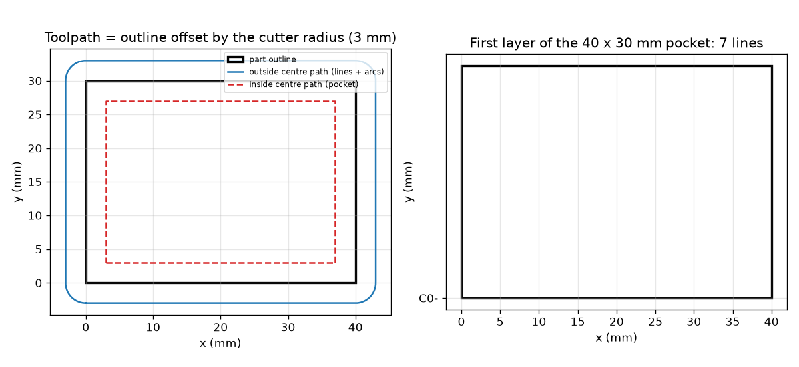
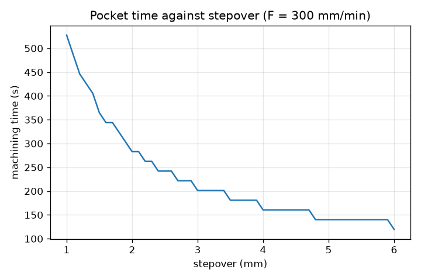

# Session 2: G-code, offsets and arcs

*Level 2 (mathematical engineering model) · about 75 minutes · opencncpath*

> This is a simplified educational model. It is not a validated design tool and must not be used for real structures, electrical installations, vehicles, industrial processes or medical decisions.

**Prerequisites**

- Session 1: the centre path and time = length / feed.
- Circles: radius, arc length = radius times angle in radians.

**Learning objectives.** After this session you can:

- Write and parse G0 and G1 moves with X, Y, Z in mm and F in mm/min.
- Offset a rectangle inwards (pocket) and outwards (profile) by the cutter radius and verify the sizes numerically.
- Build G2/G3 arcs with I, J centre offsets and verify the endpoint and the radius.
- Plan a rectangular pocket: stepover, lines, layers and time.

## A. Real-world problem
A CNC controller reads text such as `G1 X10 Y5 F300`. You will write that text with a tiny Python generator, read it back to check the geometry, and use it to plan a pocket: a 40 x 30 mm pocket, 5 mm deep, with a 6 mm cutter taking at most 2 mm depth per pass. How many passes and lines are needed, and how long will it take? Educational toolpath geometry only: real machining needs trained operators, machine-specific post-processing and safety checks.

## B. Concept and theory
A G-code line is a list of words, each a letter and a number. G0 is a rapid move (not cutting) and G1 a straight cutting move; X, Y, Z are target coordinates in mm (G21 mm, G90 absolute); F is the feed in mm/min. G2 is a clockwise and G3 a counter-clockwise circular arc to (X, Y); I and J are the offsets from the START point to the arc centre, so the centre is (x0 + I, y0 + J). A valid arc has the same radius sqrt(I^2 + J^2) at the start and at the end, and its length is the radius times the swept angle in radians. Words are modal: a missing coordinate, the G word and F keep their last values. The toolpath is an offset curve of the part outline: for a pocket the cutter centre follows the outline moved inwards by r (a w x h rectangle becomes (w - 2r) x (h - 2r)); for a profile around a part it follows the outline moved outwards by r, and the rectangle's corners become arcs of radius r. A pocket is cleared with zigzag lines along x spaced by at most the stepover s, in layers of at most the depth of cut. The time is the cutting length divided by the feed, plus the plunge.

| Symbol | Meaning | Unit |
|---|---|---|
| X, Y, Z | target coordinates (absolute) | mm |
| F | feed rate | mm/min |
| I, J | arc centre minus arc start | mm |
| r | cutter radius (D/2) | mm |
| D | cutter diameter | mm |
| s | stepover between lines | mm |
| n | number of zigzag lines | no unit |
| N | number of depth layers | no unit |
| doc | depth of cut per layer | mm |
| T | machining time | s |

**Assumptions**

- Metric units (G21) and absolute coordinates (G90); the pocket corner is at (0, 0), the stock top at Z = 0.
- Constant feed on every cutting move; no acceleration at corners.
- Plunge feed 100 mm/min, 0.5 mm of air above the stock; rapids at an assumed 3000 mm/min.
- No wall finishing lap in this session (Session 3 shows what that leaves).
- Teaching numbers, not recommended cutting conditions.

$$ T=\frac{L}{F}\cdot 60\ \text{s}\quad(L\ \text{in mm},\ F\ \text{in mm/min}) $$

$$ \text{centre}=(x_0+I,\ y_0+J),\qquad R=\sqrt{I^2+J^2},\qquad L_{\text{arc}}=R\,\theta $$

$$ \text{pocket path: }(w-D)\times(h-D),\qquad \text{profile path: }(w+D)\times(h+D)\ \text{with corner arcs of radius }r $$

$$ n=\left\lceil\frac{h-D}{s}\right\rceil+1,\qquad N=\left\lceil\frac{\text{depth}}{doc}\right\rceil,\qquad L_{\text{layer}}=n\,(w-D)+(h-D) $$

$$ T=\frac{N\,L_{\text{layer}}}{F}\cdot 60+\frac{\text{depth}+0.5}{F_{\text{plunge}}}\cdot 60 $$

## C. Visual explanation
The first figure shows the 40 x 30 mm outline with its two offset paths: the dashed inside offset (3 mm to 37 mm by 3 mm to 27 mm) for a pocket, and the outside offset with four corner arcs for a profile. The second panel shows the first layer of the pocket as 7 zigzag lines. The last figure plots the pocket time against the stepover: the time falls steeply at small stepovers and flattens because the number of lines n is a whole number.

*Offsets of a 40 x 30 mm outline by 3 mm (pocket inside, profile outside with corner arcs) and the first layer of the pocket.*

*Pocket time against stepover for a 6 mm cutter at 300 mm/min.*

## D. Interactive simulation
Run the lesson (`python start.py 2`), then open the live app: [Session 2: plan a rectangular pocket](https://krunalpanchal1995.github.io/opencncpath/session-02/) (or `app.html` in this folder). Change the cutter diameter, stepover, depth of cut and feed. Watch the number of lines and layers change and the time in the readout; open the time graph to see the cost of a small stepover.

**Challenge.** Clear the 40 x 30 x 5 mm pocket in at most 120 s with a stepover no larger than 75 percent of the cutter diameter.

## E. Worked example and experiment
**Problem.** Design: clear a 40 x 30 mm pocket, 5 mm deep, with a 6 mm cutter and a 2 mm depth of cut per pass at 300 mm/min. Choose the stepover and the number of passes and estimate the time.

1. The centre must cover (40 - 6) x (30 - 6) = 34 x 24 mm, so lines run 34 mm long and cover a 24 mm span.
2. Choose the stepover at most 75 percent of the diameter: 4.5 mm. Lines n = ceil(24 / 4.5) + 1 = 7, spaced evenly at 24 / 6 = 4.0 mm.
3. Layers N = ceil(5 / 2) = 3, each 5 / 3 = 1.667 mm deep.
4. One layer: 7 * 34 + 24 = 262 mm; three layers: 786 mm.
5. Cutting time = 786 / 300 min = 2.62 min = 157.2 s. Plunge: 5.5 mm / 100 mm/min = 3.3 s. Total 160.5 s.
6. Parsing our own G-code gives the same 160.5 s for cutting and plunging; adding rapids at 3000 mm/min gives 162.6 s.

**Answer.** Stepover 4.5 mm (7 lines, 4 mm apart), 3 layers, 786 mm of cutting: about 160.5 s, or 162.6 s with rapids.

**Experiment.** Load the generated G-code into a free G-code viewer or simulator and compare its time estimate and its picture with this model, then (only if a trained operator supervises a real machine) compare with a stopwatch. A real machine will usually be slower: it accelerates and slows at every line end, the cutter and the material limit the feed, and a finishing lap is normally added. The model assumes constant feed and no finishing lap.

## F. Assessment and design challenge
**Question type A: Conceptual.** The same start (10, 0) and end (0, 10) with I-10 J0 are used for G3 and for G2. Do they give the same arc? Why does the centre not change?

Hint

I and J are measured from the start point. Which way round does each word go?

Step-by-step solution

The centre is (10 - 10, 0 + 0) = (0, 0) for both, because it depends only on the start and on I, J. G3 goes counter-clockwise and sweeps 90 degrees (length 15.708 mm); G2 goes clockwise the long way round and sweeps 270 degrees (length 47.124 mm). The endpoints are the same but the arcs are not.

**Question type B: Numerical.** An arc starts at (20, 0), ends at (0, 20) and is written G3 X0 Y20 I-20 J0. Find the centre, check the end radius and find the arc length.

Hint

centre = start + (I, J); length = R * angle.

Step-by-step solution

Centre = (20 - 20, 0 + 0) = (0, 0). Start radius = 20 mm; end radius = sqrt(0 + 400) = 20 mm, so the arc is valid. Counter-clockwise from 0 to 90 degrees is pi/2 radians, so the length is 20 * pi/2 = 31.416 mm. Units: mm.

**Question type C: Graph and simulation interpretation.** On the time-against-stepover graph, the time is 282.9 s at a stepover of 2 mm and 119.7 s at 6 mm. Why does the curve fall quickly at first and then flatten? Why can the stepover not exceed 6 mm?

Hint

Count lines: n = ceil(24 / s) + 1. What does the cutter diameter limit?

Step-by-step solution

Time is mostly the number of lines times the line length, and n falls like 1 / s: halving the stepover roughly doubles the lines, but at large s the lines cannot drop below a few (5 lines at 6 mm). Because n is a whole number the curve also has small steps. The stepover cannot exceed the cutter diameter (6 mm) because then the strip between two lines is wider than the cutter and stays uncut.

**Question type D: Design and optimisation challenge.** Design: repeat the plan with an 8 mm cutter (stepover at most 75 percent of D, depth of cut 2 mm, 300 mm/min, plunge 100 mm/min). How many lines, how much cutting length and what time? Is it faster than the 6 mm cutter, and what is the catch?

Hint

Span = 30 - 8 = 22 mm; line length = 40 - 8 = 32 mm; stepover at most 6 mm.

Step-by-step solution

n = ceil(22 / 6) + 1 = 5 lines, spaced 5.5 mm. One layer: 5 * 32 + 22 = 182 mm; three layers 546 mm. Time = 546 / 300 * 60 + 3.3 = 109.2 + 3.3 = 112.5 s, faster than 160.5 s. Catch: a bigger cutter rounds the inside corners with a larger radius (4 mm instead of 3 mm), needs more force and may exceed what the machine can hold; Session 3 measures the corner leftover.

Score yourself with [RUBRIC.md](../../RUBRIC.md). Print the [activity sheet](activity_sheet.md) to work on paper.

## Common misconceptions
| Common misconception | What is actually true |
|---|---|
| X10 means move 10 mm. | In absolute mode (G90) X10 means go to the position x = 10 mm; the move length depends on where you were. |
| I and J are the coordinates of the arc centre. | I and J are offsets from the arc start point to the centre. |
| F is the feed in mm per revolution. | In the form used here F is the feed in mm per minute along the path. |
| A pocket path is the outline offset outwards. | A pocket is cleared by a path offset inwards by r; the outward offset is for a profile around a part. |

## Glossary
- **G-code**: text program of machine words such as G1 X10 Y5 F300
- **modal**: a word stays in force until it is changed
- **G0 and G1**: rapid move and straight cutting move
- **G2 and G3**: clockwise and counter-clockwise circular arc
- **offset curve**: a curve moved sideways by a fixed distance, here the cutter radius
- **stepover**: distance between neighbouring cutting lines
- **depth of cut**: how deep one pass removes material

## Finish
1. Do the three coding tasks in [exercises.md](exercises.md).
2. Run `python start.py 2` again after your changes. It ends with the checkpoint; when it prints `PASS`, you are done. (Checkpoint only: `python start.py check 2`.)

Next: [Session 3](../session-03/README.md)
