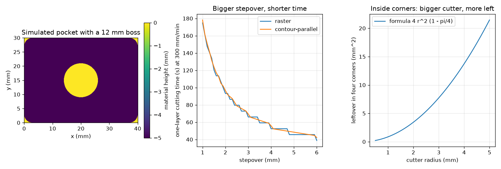
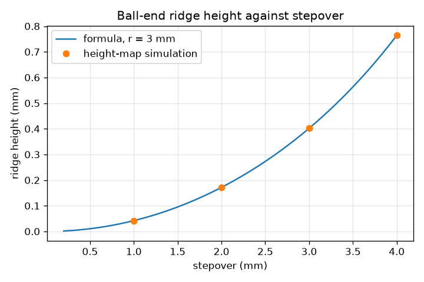

# Session 3: Pocketing strategies and a simulation that checks them

*Level 3 (simulation and validation) · about 90 minutes · opencncpath*

> This is a simplified educational model. It is not a validated design tool and must not be used for real structures, electrical installations, vehicles, industrial processes or medical decisions.

**Prerequisites**

- Session 2: offsets, G-code, lines and layers.
- Session 2: time = length / feed.

**Learning objectives.** After this session you can:

- Compare raster (zigzag) and contour-parallel pocketing by length, time and leftover.
- Compute the ridge height left by a ball-end cutter, h = r - sqrt(r^2 - (s/2)^2), and check it on a simulated height-map.
- Use MRR = width x depth x feed and chip load f_z = F / (N z), and check the removed volume by simulation.
- Detect the failure cases: inside corners, uncut strips, a wrong-direction offset and a cutter too big for a slot.

## A. Real-world problem
A toolpath that looks right can still leave material behind, cut too much, or take twice as long as it should. We cut a simulated block on a grid of heights (a height-map), subtract the cutter footprint along the path, and compare the removed volume and the leftover ridges with formulas. At the end we generate G-code for a pocket with a round boss and check its removed volume. Educational toolpath geometry only: real machining needs trained operators, machine-specific post-processing and safety checks; the feeds and speeds here are teaching numbers.

## B. Concept and theory
The height-map stores the height of the material top in each grid cell (0 = original top). A flat-end cutter at (x, y) with tip height z sets every cell within its radius to at most z; a ball-end cutter of radius r leaves height z + r - sqrt(r^2 - rho^2) at distance rho from its axis. Raster pocketing uses parallel lines; contour-parallel pocketing offsets the outline inwards by r, r + s, r + 2s, and so on. Neighbouring ball-end passes s apart leave a ridge midway of height h = r - sqrt(r^2 - (s/2)^2); inversely s = 2 sqrt(2 r h - h^2). The material removal rate is MRR = a_e a_p F (radial width, axial depth, feed) and the chip load is f_z = F / (N z) for N rev/min and z teeth. A round flat cutter cannot reach into a sharp inside corner: each of the four corners keeps r^2 (1 - pi/4) of area, so the pocket keeps 4 r^2 (1 - pi/4). A stepover larger than the cutter diameter D leaves strips of width s - D. An offset in the wrong direction makes the cutter cut outside the pocket. A slot narrower than the cutter cannot be cut, and the planner must report that.

| Symbol | Meaning | Unit |
|---|---|---|
| r | cutter radius | mm |
| s | stepover between passes | mm |
| h | ridge (scallop) height | mm |
| a_e | radial width of cut | mm |
| a_p | axial depth of cut | mm |
| F | feed rate | mm/min |
| N | spindle speed | rev/min |
| z | number of cutting teeth | no unit |
| f_z | chip load, feed per tooth | mm |
| MRR | material removal rate | mm^3/min |

**Assumptions**

- The height-map has 0.1 mm cells (0.05 or 0.025 mm for the ridge and corner tests); cells are tested at their centres.
- Cutters are perfect flat or ball shapes; no deflection, wear or vibration.
- Constant feed; rapids at 3000 mm/min; plunge 100 mm/min.
- Rectangles, circles and straight offsets only, so every claim has an analytic check.
- Teaching numbers, not recommended cutting conditions.

$$ h=r-\sqrt{r^{2}-\left(\frac s2\right)^{2}},\qquad s=2\sqrt{2rh-h^{2}} $$

$$ \mathrm{MRR}=a_e\,a_p\,F,\qquad f_z=\frac{F}{N\,z} $$

$$ A_{\text{corners}}=4\,r^{2}\left(1-\frac{\pi}{4}\right) $$

$$ A_{\text{gouge}}=(w+4r)(h+4r)-(4-\pi)r^{2}-wh\quad(\text{centre path offset outwards by } r) $$

$$ V=\left(wh-\pi R_b^{2}-4r^{2}\left(1-\tfrac{\pi}{4}\right)\right)\,\text{depth}\quad(\text{pocket with a boss of radius } R_b) $$

## C. Visual explanation
The first panel is the simulated height-map of the boss pocket after the G-code is run: the floor at -5 mm, the untouched boss at 0. The second panel shows the one-layer cutting time of raster and contour-parallel paths against the stepover, and the third the corner leftover 4 r^2 (1 - pi/4), which grows with the square of the cutter radius. The ridge figure plots the formula and the height-map simulation: the dots lie on the curve.

*Simulated boss pocket, one-layer time against stepover for two strategies, and the corner leftover against the cutter radius.*

*Ball-end ridge height against stepover: formula (line) and height-map simulation (dots) for a 3 mm radius.*

## D. Interactive simulation
Run the lesson (`python start.py 3`), then open the live app: [Session 3: ridges and the stepover trade-off](https://krunalpanchal1995.github.io/opencncpath/session-03/) (or `app.html` in this folder). Change the ball radius, the stepover and the feed. Look at the section view to see the ridge between passes, then the ridge and time graphs to see the trade-off.

**Challenge.** Finish the 40 x 30 mm face with a ridge no higher than 0.05 mm in at most 150 s.

## E. Worked example and experiment
**Problem.** A ball-end cutter of radius 3 mm makes parallel passes 2 mm apart. Find the ridge height, then the largest stepover that keeps the ridge at 0.05 mm or less, and check by simulation.

1. h = 3 - sqrt(3^2 - 1^2) = 3 - sqrt(8) = 3 - 2.828 = 0.1716 mm.
2. For h = 0.05 mm: s = 2 sqrt(2 * 3 * 0.05 - 0.05^2) = 2 sqrt(0.2975) = 2 * 0.5454 = 1.0909 mm.
3. Use s = 1.0 mm (a convenient value below the limit): h = 3 - sqrt(9 - 0.25) = 0.0420 mm. With 1.1 mm the ridge is 0.0508 mm, just too high.
4. The height-map simulation of 5 passes at 2 mm gives 0.1716 mm (and 0.0420 mm at 1 mm), equal to the formula to better than 0.002 mm.

**Answer.** Ridge 0.1716 mm at 2 mm stepover; to stay at 0.05 mm or less use at most 1.0909 mm, for example 1.0 mm (ridge 0.0420 mm). The simulation agrees.

**Experiment.** On a soft test material (soap, clay or modelling wax) with a hand-held ball-nose tool, or on a printed model, draw two parallel grooves and measure the ridge between them with a ruler edge or calipers. The ridge will be a little different from the formula because the tool is not a perfect sphere, the material crumbles and the groove edges are not sharp: the model uses a perfect sphere and a perfect surface. The roughness of a real part also depends on tool deflection and vibration.

## Real-world application and mini-project: Generate G-code for a pocket with a boss and check it
A 40 x 30 mm pocket, 5 mm deep, has a round boss of diameter 12 mm in the middle at (20, 15) that must stay. Use a 6 mm flat cutter, 2 mm depth of cut per layer, stepover 4 mm, feed 300 mm/min, plunge 100 mm/min and rapids at 3000 mm/min. Use `boss_pocket_gcode` from Session 3, parse the text back with `read_moves`, simulate it on a height-map with `simulate_moves`, and compare the removed volume with the analytic volume.

**Deliverable:** A script that writes the G-code file, prints the estimated time and the simulated and analytic removed volumes with their percentage difference, and saves a picture of the carved height-map.

**Success looks like:** The estimated time is 327 s (about 5.5 minutes), the analytic volume is 5395.9 mm^3, the simulated volume agrees within 0.5 percent, the boss height stays 0 and the floor is at -5 mm.

## F. Assessment and design challenge
**Question type A: Conceptual.** Why does a bigger stepover finish a job faster but leave more material behind? Why does the contour-parallel path with stepover equal to the diameter still leave cusps in the corners?

Hint

Count lines. Then think about where two offset rings meet at a rectangle corner.

Step-by-step solution

A bigger stepover needs fewer lines, so the path is shorter and the time smaller, but the ridge between lines grows (for a ball end) and above the diameter whole strips are left. In contour-parallel paths the rings at a rectangle corner meet at 90 degrees; the round cutter covers a rounded patch, and with spacing equal to the diameter (6 mm for a 3 mm radius) the corner of the next ring is out of reach in the diagonal direction: the simulation clears only 1180.9 mm^2 instead of 1192.3 mm^2.

**Question type B: Numerical.** A cutter has 2 teeth, runs at 8000 rev/min and feeds at 480 mm/min. Find the chip load. Then find the MRR for a_e = 3 mm, a_p = 1.5 mm and F = 400 mm/min.

Hint

f_z = F / (N z); MRR = a_e a_p F.

Step-by-step solution

f_z = 480 / (8000 * 2) = 0.03 mm per tooth. MRR = 3 * 1.5 * 400 = 1800 mm^3/min. Units: mm/min divided by rev/min times teeth gives mm per tooth; mm * mm * mm/min gives mm^3/min. These are teaching numbers, not recommended cutting conditions.

**Question type C: Graph and simulation interpretation.** In the corner-leftover graph, read the leftover area for a cutter radius of 3 mm and of 5 mm. What happens when the radius doubles, and what does that say about choosing a cutter?

Hint

The curve is 4 r^2 (1 - pi/4).

Step-by-step solution

About 7.73 mm^2 at 3 mm and 21.46 mm^2 at 5 mm. The curve rises with the square of r: doubling the radius quadruples the leftover (3.43 mm^2 at r = 2 and 13.73 mm^2 at r = 4 also follow the formula). A bigger cutter clears faster but leaves bigger corner fillets, so a smaller cutter is needed to finish the corners (rest machining).

**Question type D: Design and optimisation challenge.** Design: a ball-end cutter of radius 4 mm must finish a 40 x 30 mm face with a ridge of at most 0.02 mm at 600 mm/min. Choose a stepover (rounded down to 0.01 mm), count the lines and estimate the time. Lines run along the 40 mm side, plus 30 mm of side-steps in total.

Hint

Use s = 2 sqrt(2 r h - h^2), then n = ceil(30 / s) + 1 and length = 40 n + 30.

Step-by-step solution

s = 2 sqrt(2 * 4 * 0.02 - 0.0004) = 2 sqrt(0.1596) = 0.7990 mm, so use 0.79 mm. Lines n = ceil(30 / 0.79) + 1 = 39. Length = 39 * 40 + 30 = 1590 mm. Time = 1590 / 600 * 60 = 159.0 s. Trade-off: a finer ridge needs many more lines and more time; a coarser stepover is faster but the surface is rougher.

Score yourself with [RUBRIC.md](../../RUBRIC.md). Print the [activity sheet](activity_sheet.md) to work on paper.

## Common misconceptions
| Common misconception | What is actually true |
|---|---|
| A bigger stepover is always better because the job is faster. | It is faster but leaves higher ridges (ball end) or uncut strips (flat end when s is above D); the finish decides the stepover. |
| The cutter can cut a sharp inside corner. | A round cutter leaves a fillet of at least its own radius; each corner keeps r^2 (1 - pi/4) of area. |
| If the toolpath is parallel to the outline, the offset direction does not matter. | The wrong direction cuts the walls or the outside: an outward offset by r removes 976.3 mm^2 outside the 40 x 30 mm pocket and nothing inside. |
| MRR depends only on the feed. | MRR = width x depth x feed: all three matter. |

## Glossary
- **height-map**: a grid storing the height of the material in each cell
- **scallop (cusp)**: the ridge left between neighbouring passes of a round cutter
- **MRR**: material removal rate in mm^3 per minute
- **chip load**: feed per tooth in mm
- **contour-parallel**: pocketing by offsets of the outline, like a spiral
- **boss**: a column of material that must stay inside a pocket
- **gouge**: cutting where material should stay

## Finish
1. Do the three coding tasks in [exercises.md](exercises.md).
2. Run `python start.py 3` again after your changes. It ends with the checkpoint; when it prints `PASS`, you are done. (Checkpoint only: `python start.py check 3`.)

Next: the [roadmap](../../promo/roadmap.md). Session 4 is yours to build.
